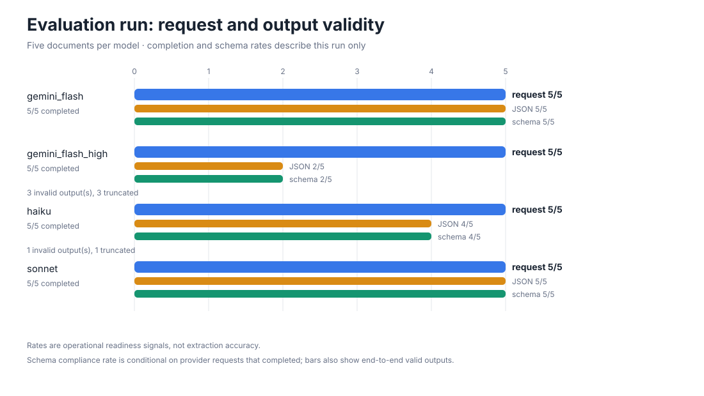
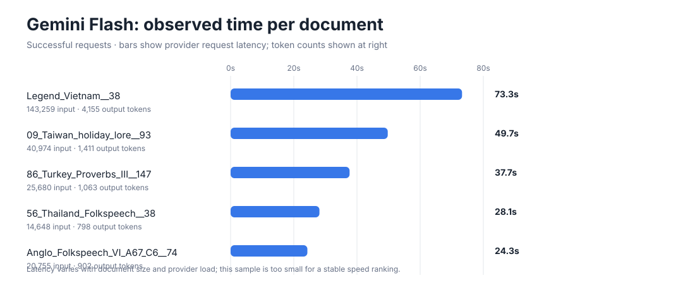

# Archive evaluation graph notes

This run measures request availability, JSON parsing, and archive schema validity. It does not measure whether extracted folklore is factually correct or complete: there are no field-level reference answers in this evaluation set.

## Run results

| Model alias | Requests completed | JSON parsed | Schema valid | What constrained the result |
|---|---:|---:|---:|---|
| gemini_flash | 5/5 (100%) | 5/5 | 5/5 | All responses passed schema validation |
| gemini_flash_high | 5/5 (100%) | 2/5 | 2/5 | 3 invalid output(s), 3 truncated |
| haiku | 5/5 (100%) | 4/5 | 4/5 | 1 invalid output(s), 1 truncated |
| sonnet | 5/5 (100%) | 5/5 | 5/5 | All responses passed schema validation |

## Charts

## Reading the charts

- **gemini_flash**: 5/5 schema-valid outputs (100% of completed responses).
- **gemini_flash_high**: 2/5 schema-valid outputs (40% of completed responses); 3 invalid output(s), 3 truncated.
- **haiku**: 4/5 schema-valid outputs (80% of completed responses); 1 invalid output(s), 1 truncated.
- **sonnet**: 5/5 schema-valid outputs (100% of completed responses).
- Gemini Flash’s 5 successful responses used 245,316 input tokens and 8,329 output tokens. Latency ranges 24.3–73.3 seconds.

## What efficacy is established

Current evidence supports only operational reliability and output-contract compliance. It does not establish that any model extracted the right folklore or captured all relevant records. To compare extraction efficacy, add a reviewed gold set with expected records and score per-field precision, recall, and F1, plus citation/source-span accuracy and human review for cultural interpretation.

Generated by `scripts/plot_evaluation.py` from `aggregate.json` and `per_document.json`.
